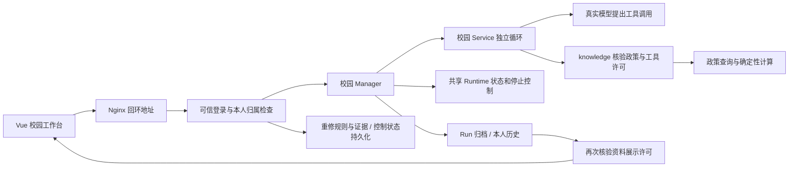

# 受控校园网页演示

当前生产 Vue 已接入登录、学分任务、本人历史和重修澄清。**用户于2026-10-06确认“P4 通过”，本机演示功能验收收口。** [人工确认记录](../evidence/controlled-web-demo/2026-10-06/p4/final-closeout/manual-acceptance.md)与P1真实模型、P2/P3夹具、实际HTTP和跨进程自动测试分开记载；没有用自动测试拼造人工结果。当前演示退出状态另行记录，不宣称生产部署或完整浏览器质量验收。

## 一次启动

先启动 Docker Desktop。可以从任何目录使用下面的绝对路径；推荐人工保留窗口入口，报错不会一闪而过：

```powershell
& 'D:\alldesk\Projects\ZhkuAgent\knowledge\scripts\open-controlled-web-demo.cmd'
```

它打开单独的CMD窗口并调用同一个演示启动器。`q`结束演示和资源后窗口仍保留，确认退出摘要，再输入`exit`关闭。环境检查也可通过此入口传`-CheckEnvironment`，只检查后留在窗口，不启动服务。

也可以在现有普通Windows终端先进入项目根目录，再运行原入口：

```powershell
Set-Location 'D:\alldesk\Projects\ZhkuAgent'
.\knowledge\scripts\start-controlled-web-demo.cmd -CheckEnvironment
.\knowledge\scripts\start-controlled-web-demo.cmd
```

`-CheckEnvironment`打印后立即结束是正常行为；原入口不负责保留新开的临时控制台窗口。位于`C:\Users\nangua`时不能使用上述相对路径，应先切目录或用绝对路径。不要在另一个本仓构建/演示仍进行时重复启动；其他仓库的Maven不应被误拦。

检查模式不连接数据库、不调用模型。正式启动会构建 Java 和 Vue，创建本次独立临时数据库与 Nginx 项目，隐藏询问三个合成账号密码。密码须为 16～64 位可打印英文字符，请自己记住，不发到聊天或截图中。账号依次是 `user-a`、`user-b`、`maintainer`，无注册。

默认浏览器地址：**http://127.0.0.1:58080/campus/login**。后端为 58123，临时库为 55439；端口占用时使用 `-WebPort`、`-BackendPort`、`-DatabasePort` 指定三个不同端口，禁止 54329，不停止占用者。

```powershell
.\knowledge\scripts\start-controlled-web-demo.cmd -WebPort 58081 -BackendPort 58124 -DatabasePort 55440
```

需要已安装 Node/npm、Java21、Maven、Docker 与供应商环境变量 `DASHSCOPE_API_KEY`。启动器查找本机实际 PowerShell7，不要求终端能识别 `pwsh`；Node/npm先找PATH，再检查已安装的Program Files/nodejs，两者均存在才使用，仅对本次构建补PATH，不自动下载或改全局配置。若普通 Windows PowerShell5.1 显示中文异常，先正常退出，再为当前窗口设置 UTF-8；不修改系统编码：

```powershell
$demoEncoding = [Text.UTF8Encoding]::new($false)
[Console]::InputEncoding = $demoEncoding
[Console]::OutputEncoding = $demoEncoding
$OutputEncoding = $demoEncoding
.\knowledge\scripts\start-controlled-web-demo.cmd
```

网页调用真实模型，仅输入虚构课程和合成问题。正常任务受既有三步、30秒及零自动重试约束；人工模式没有12题样本的批次总量上限或货币硬上限，建议本次只提交一至两次正常学分任务，不重复连点。

## 5～8 分钟演示顺序

1. 用 `user-a` 登录，验证密码默认隐藏、眼睛按钮只切换显示。点击“使用示例课程”，提交 ART01 1.5 与 HIS02 2 学分。正常答案应解释合计 3.5 与合成政策每学期4学分上限，并显示 `web-demo-v1` 来源；真实模型可能失败，按实际结果记录，不能用截图替代本次执行。
2. 打开“我的历史”，按提交时间选择学分核对记录，核对答案与出处；任务编号保留在链接中，页面不显示内部状态与工具轨迹。进入独立浏览器或隐私窗口，用 `user-b` 登录。B 不应看到 A 的列表，直接访问 A 的 Run/历史链接也不应出现 A 的正文。两个普通标签共用 Cookie，不能用于账号隔离验收。维护者登录后三个用户功能不可执行。
3. 返回 A 的“重修咨询”，创建会话，提问“选修课挂科了可以重修吗？”。显示课程类型追问后保留含 `sessionId` 的地址，在终端输入 `r` 回车。网页入口会先关闭，再重启服务并恢复；本次库保留，旧登录失效。刷新、重新以 A 登录，在有效期内读取原待补状态，填写“专业选修课”取得带出处答复。不要超过10分钟有效期。恢复的是澄清控制状态，不是完整聊天，也不是学分任务续跑。
4. `r` 之后可用原 Run 地址观察在线记录不存在，再查本人历史。不能由404推断它属于别人，也不能重提旧任务代替历史查询。取消任务若已结束无需制造失败；运行中可点击“取消任务”，页面在执行未结束时显示“正在取消”。只有服务端终态与 `terminated=true` 才表示该运行收敛，页面不再展示内部清理字段。稳定取消/超时证据见自动化测试。
5. 在终端输入 `q` 回车，等待关闭摘要。它关闭本次 Nginx、后端和临时库；整个演示退出后数据删除，下次启动是另一套临时数据。`r` 的保留不等于退出后永久保留。不要直接关闭终端；若意外关闭，先核对本次证据目录中的资源名称再清理，不停止其他项目。

## 人工验收一次记录

请只记录现象，不提供密码、Cookie、CSRF 或 Key：

- 中文、隐藏密码输入、页面启动，`r` 与 `q` 是否成功。
- 密码反复显隐是否保留精确内容、眼睛点击是否未提交、失败提交后是否清空并恢复隐藏；粘贴和现成密码管理器按实际执行记录。
- A 正常任务/出处/本人历史，独立 Cookie 的 B 隔离，维护者拒绝，重修不同PID补答。
- 桌面、768和360宽度是否可用；实际浏览器菜单200%缩放是否无遮挡。改变视口不是缩放。
- Tab焦点、键盘提交、第二浏览器与读屏按真实执行记录；没有读屏设备时写未执行。
- 网络/存储检查：请求走同源受控前缀，页面不将密码、身份、正文或token写入 Local/Session Storage；浏览器 HttpOnly 登录Cookie是正常框架认证，不能要求没有Cookie。

资料撤回、身份停用和可控运行阻塞由专用合成自动化测试验证；当前人工启动器没有治理入口，也没有稳定的暂停模型按钮。不要将快速取消按钮点击当成阻塞/资源测试，或直接在其他数据库里修改资料。

## 链路与展示重点



模型提出调用，程序决定执行许可；取消请求不等于物理释放；执行成功、归档确认与正文可读分别表达。当前仍为单实例本机合成演示，非学校官方系统，无真实学生效果、生产多人部署、Run续跑、完整聊天恢复或后端提交幂等承诺。

证据入口：[本版账本](../evidence/controlled-web-demo/2026-10-06/README.md)、[P1真实模型](../evidence/controlled-web-demo/2026-10-06/p1-closeout/acceptance.md)、[P2页面](../evidence/controlled-web-demo/2026-10-06/p2/acceptance.md)、[P3](../evidence/controlled-web-demo/2026-10-06/p3/acceptance.md)、[P4当前记录](../evidence/controlled-web-demo/2026-10-06/p4/acceptance.md)、[Nginx职责](nginx-local-preview.md)。
