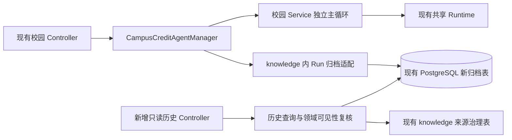

# Milestone 3A：校园 Run 归档与重启对账技术设计

日期：2026-10-03，Asia/Shanghai。状态：**已确认进入实施计划编写；尚未实施**。

本轮计划核对补充的明确决策：现有 AgentStopReason 没有宿主关闭/失锁原因。用户已选择保持共享 Runtime 不变，采用关闭准入与有界排空；未收敛记录留待重启对账，宿主主动停止任务另立后续修复。不得借用 USER_REQUEST/RUN_TIMEOUT，也不承诺关闭流程能强制停止忽略中断的任务或在 5 秒内结束整个 JVM。

本阶段让单人本机预览在明确开启归档后，能查询保留期内的校园运行记录，并识别旧进程没有留下最终结果的运行。不恢复执行，不把归档成功当作业务成功。先接校园 Manager；通用 Agent 保持现状。

本轮只读源码、核对历史证据和编写本文件。没有执行数据库、模型、迁移或新测试，没有提交、推送。文中的新增类型、字段、接口和数值均为实施规格，不是当前已有能力。

## 1. 基线与真实源码依据

当前 HEAD：`135c9d3e58ddbf99f9507ed3f952bd839fd99b86`。工作区已有未提交的前序阶段修改，不能把整个 HEAD diff 当成 3A 的改动。

| 当前事实 | 文件、类与方法依据 |
| --- | --- |
| 校园运行记录在内存 HashMap；准入锁保护容量检查与插入 | [CampusCreditAgentManager.java](../../../knowledge/src/main/java/com/zhku/knowledge/campusagent/CampusCreditAgentManager.java)，`start`，54–69 行 |
| 当前先创建/绑定 Task，再安排超时并提交执行器 | 同上，`start`，71–81 行；[AgentRunTask.java](../../../agent-runtime/src/main/java/com/zhku/agent/agent/runtime/AgentRunTask.java)，`create`，30–53 行 |
| Service 设置业务终态、清理、完成 termination Future，然后构建 Result | [CampusCreditAgentService.java](../../../knowledge/src/main/java/com/zhku/knowledge/campusagent/CampusCreditAgentService.java)，`run(AgentRunContext, Request)`，111–135 行 |
| Manager 发布完整 completion 后才发共享终止事件 | Manager，`start`，72–76 行；拒绝分支 82–90 行 |
| 在线 HTTP 的 terminated 要求 completion 已发布且清理 Future 已完成 | Manager，`snapshot`，127–137 行 |
| 共享 snapshot 的 terminated 由宿主 publishTermination 设置；观察器异常被隔离 | [AgentRunContext.java](../../../agent-runtime/src/main/java/com/zhku/agent/agent/runtime/AgentRunContext.java)，`publishTermination`，160–166 行；`deliver`，190–198 行 |
| 请求停止可能中断正在运行的工作线程 | 同上，`requestStop`，331–365 行，取消 Task 相关代码 545–554 行 |
| 当前 API 的创建、查询、取消及错误结构 | [CampusAgentPreviewController.java](../../../knowledge/src/main/java/com/zhku/knowledge/web/CampusAgentPreviewController.java)，`start/find/cancel`，31–65 行；全局 `/api` 见 [application.yml](../../../knowledge/src/main/resources/application.yml)，15 行 |
| 共享终态没有历史中断枚举，约束明确区分成功、不完整、失败、取消 | [AgentRunState.java](../../../agent-runtime/src/main/java/com/zhku/agent/agent/runtime/AgentRunState.java)；[AgentRunSnapshot.java](../../../agent-runtime/src/main/java/com/zhku/agent/agent/runtime/contract/AgentRunSnapshot.java)，11–30 行 |
| 默认 Session 是内存存储；已有 JDBC 存储只保存澄清控制状态 | [ZhkuLocalPreviewConfiguration.java](../../../knowledge/src/main/java/com/zhku/knowledge/web/ZhkuLocalPreviewConfiguration.java)，`zhkuLocalPreviewConversationStore`，77–79 行；[JdbcConversationStore.java](../../../knowledge/src/main/java/com/zhku/knowledge/conversation/JdbcConversationStore.java)，`savePending/cancel`；[V12](../../../knowledge/src/main/resources/db/migration/V12__create_conversation_session_store.sql) |
| 可复用数据库配置工厂，但没有统一可注入 DataSource Bean | [LocalKnowledgePublisherFactory.java](../../../knowledge/src/main/java/com/zhku/knowledge/publication/LocalKnowledgePublisherFactory.java)，`createDataSource(Environment)`，35 行；预览私有工厂见 `ZhkuLocalPreviewConfiguration.localPreviewDataSource`，243 行 |
| 来源包含 ID、版本、定位，缺少不可变版本 ID 与执行时 checksum | [LocalPreviewConversationFacade.java](../../../knowledge/src/main/java/com/zhku/knowledge/web/LocalPreviewConversationFacade.java)，`ConversationAnswer`，334–341 行；Service 的 `completeSource`，302–306 行，未检查 sourceId |
| 当前证据检索只找最新合格资料，不能直接判断某个历史来源 | [JdbcCreditLimitEvidenceFinder.java](../../../knowledge/src/main/java/com/zhku/knowledge/conversation/publicelective/JdbcCreditLimitEvidenceFinder.java)，`find`，25–60 行 |
| 同一来源可原地覆盖版本和内容；旧资料可归档并改为内部可见 | [ReviewedKnowledgePublisher.java](../../../knowledge/src/main/java/com/zhku/knowledge/publication/ReviewedKnowledgePublisher.java)，`upsertSource`，198–247 行；`archivePublishedScope`，251–265 行；`upsertChunk`，274 行起 |

历史已验收基线见 [Milestone 2.6 验收](../../evidence/milestone-2.6/05-验收记录.md)及[测试统计](../../evidence/milestone-2.6/04-测试统计.csv)：相关回归 188 项、专用临时数据库 11 项、脚本替身 8 项通过。**这些是前序结果，本轮没有重跑。**模型仍为测试替身，数据库验收不等于真实模型或真实 HTTP 监听验收。

实施前必须重新保存 HEAD、git status、受影响文件哈希与测试报告，并重跑原相关回归。不得覆盖 1A、1B、2、2.5、2.6 的原证据。

## 2. 本阶段范围与后续拆分

| 阶段 | 能力 | 本轮决定 |
| --- | --- | --- |
| 3A | 校园 Run 准入元数据、最终结果归档、独立历史查询、单实例排他、重启对账、保留限制 | 先设计、后独立实施验收 |
| 3B | 客户端提交幂等键、同键不同载荷拒绝、并发重复提交与键过期 | 不夹带进 3A；3A 不解决客户端重提导致的新 Run |
| 3C | 有界事件诊断、资源预算与选定的有限重试 | 不做完整事件存储；3A 只设置存储操作的必要时限与固定错误 |
| 3D | 现有 JDBC Session 可选接线 | 单独决定；不声称它能保存完整聊天历史 |

3A 不修改两条主循环，不改共享 Runtime，不增加业务、认证、真实模型、MCP、多 Agent、长期记忆、分布式调度或通用工作流。政策、证据、工具白名单、调用顺序和转人工继续在 knowledge。

比较过三种做法：只保存最后结果无法识别“受理后崩溃”；全部运行事件持久化会扩大故障面；**推荐准入记录加一次最终原子归档**，足以识别未确认结局，同时不要求重写循环。

## 3. 三种归档状态与执行状态分离

| archiveStatus | 精确定义 | 可以推断什么 |
| --- | --- | --- |
| ADMITTED | 准入元数据已记录，最终执行事实尚未归档 | 不证明已开始执行，也不证明客户端收到了 202 |
| FINALIZED | 最终执行事实和允许保存的结果在同一事务中提交 | 可知执行结局；不证明 HTTP 已送达或最终事件已发布 |
| INTERRUPTED | 新 owner 对账确认旧 owner 没有最终归档 | 执行结果未确认；工具可能执行过，不能自动重放 |

状态转换只允许 `ADMITTED → FINALIZED` 或 `ADMITTED → INTERRUPTED`。关闭后的记录不改写执行结局，保留到期后才删除。

执行事实沿用共享的 state、stopReason、EndReason、RuntimeError 分类，不新增共享 INTERRUPTED。历史中断的 execution 字段为空，不伪造 FAILED/CANCELLED、USER_REQUEST 或 terminated=true。FINALIZED 既可以是 SUCCEEDED，也可以是 INCOMPLETE、FAILED、CANCELLED。

**历史 DTO 不包含 terminated。**当前 termination Future 证明清理阶段收敛；Manager completion 与 RUN_TERMINATED 才证明宿主完整结果发布。归档提交发生在后者之前，不能声称旧进程一定发布过它们。

## 4. 最小组件与接线



只增加一个窄归档存储接口，便于确定性故障测试；不创建通用持久化框架或新 Planner。归档字段及校园答案留在 knowledge，不塞入 agent-runtime。

归档关闭时：沿用当前构造入口和全部在线行为，不连接归档库，不启动 owner 监控。归档开启时：Manager 注入归档存储，新增历史 Controller 随开关注册。禁止数据库故障后偷偷降级到无归档模式继续受理。

开启归档时要求显式配置数据库 URL，不能悄悄沿用工厂默认的演示库地址。实施与验收连接只来自受控临时库配置，启动器和脚本都检查目标；默认关闭不改变既有预览配置。

## 5. 数据规格

建议两张新表，不更改已有业务表。以下是逻辑规格，不是本轮迁移代码。

### 5.1 campus_agent_runtime_owner

| 字段 | 类型和约束 | 用途 |
| --- | --- | --- |
| owner_key | 固定主键文本 `campus-credit-preview` | 单数据库、单知识预览实例的协调行 |
| epoch | bigint，非负、接管时递增 | 拒绝旧宿主写入；溢出拒绝启动 |
| instance_id | UUID | 每次进程启动新生成，不作为用户身份 |
| claimed_at | timestamptz | 数据库记录接管时间 |

不使用过期时间租约、不凭 heartbeat 过期抢占。owner 行存在不等于实例仍存活；启动排他由数据库 session lock 决定。

### 5.2 campus_agent_run_archive

| 字段 | 类型/约束 | 保存规则 |
| --- | --- | --- |
| run_id | UUID 主键 | 与现有 Context.runId 相同，所有内部确认沿用同一 ID |
| owner_instance_id / owner_epoch | UUID / bigint | 准入时固定，关闭后不改为新 owner |
| revision | bigint，初始 0 | FINALIZED 或 INTERRUPTED 时加 1；条件更新防覆盖 |
| task_kind | 固定文本 `CAMPUS_CREDIT_SUMMARY` | 不记录原始问题或课程输入 |
| archive_status | 上述三值 | 数据库 CHECK 限定 |
| schema_version / writer_version | 正整数 / 有界非敏感文本 | DTO 解码版本与应用构建标识；不把 HEAD 当工作区内容证明 |
| admitted_at | timestamptz | 准入写入时的数据库时间 |
| execution_finished_at | 可空 timestamptz | 宿主观察到执行收敛的时间；不可用于跨进程排序证明 |
| closed_at / retained_until | 可空 timestamptz | 关闭记录时的 DB 时间及保留截止；不是精确 commit 回执时刻 |
| execution_state / stop_reason / end_reason | 可空受控文本 | 仅 FINALIZED 保存共享执行终态事实 |
| current_step | 可空非负整数 | 已有 Runtime 快照值 |
| error_category / error_code | 可空受控文本 | 固定 RuntimeError 分类和代码，不保存异常原文 |
| business_status / failure_category | 可空受控文本 | 现有校园结果/HTTP 分类；拒绝分支无 business_status |
| cleanup_outcome | 可空 SUCCESS/FAILED | 清理动作已尝试并收敛；失败时不承诺资源全部释放 |
| result_payload | 可空有界 JSON | 白名单答案与来源引用，不能直接序列化 Result/Snapshot/steps |
| payload_disposition | 可空 STORED/NOT_APPLICABLE/SUPPRESSED | 说明正文是否保存，不改变执行成功事实 |
| payload_reason | 可空固定代码 | 例如 NO_SOURCE_REFERENCE、SOURCE_NOT_VISIBLE、PAYLOAD_TOO_LARGE |
| interruption_reason | 可空固定 `PREVIOUS_OWNER_RESULT_UNCONFIRMED` | 仅 INTERRUPTED |

约束：ADMITTED 没有最终事实/正文/关闭时间；FINALIZED 必须有共享终态及关闭时间，允许正文因门禁或尺寸限制为空；INTERRUPTED 必须有关闭时间与中断原因，执行终态/正文为空。清理失败时遵循当前真实 FAILED 及 RuntimeError，不用旧成功 Outcome 覆盖它。

最终写入原子包含 execution facts、payload disposition、可选 payload、revision 和归档状态。**不得先更新 FINALIZED，稍后再写答案。**不得给 source_id 加级联删除外键，以免资料删除连运行元数据一起删除。

索引最少为：run_id 主键；`(admitted_at DESC, run_id DESC)` 分页；`(archive_status, retained_until)` 到期清理；旧 owner ADMITTED 对账索引。实施时核查执行计划，无须为了预期的分布式查询增加索引。

### 5.3 内容白名单与边界

只为正常校园 ANSWERED 保存服务端组成的答案及 ConversationAnswer 的必要公开字段（conclusion、basis、sourceId、sourceTitle、sourceVersion、sourceLocator、applicableScope）。先由 knowledge 门禁核查来源，再保存；sourceId 缺失或核查失败则只保存执行元数据及固定抑制原因。

INCOMPLETE、FAILED、CANCELLED 和执行器拒绝只保存受控分类，不保存任意 policyGateway.message；历史页面使用固定提示。原 HTTP 仍返回原内容。

不保存 request.question、课程列表、模型消息、Prompt、工具参数/原始结果、steps 明细、密钥、密码、异常 cause 或堆栈。日志只允许 runId、instanceId、epoch、动作、固定错误码、耗时，不输出 JDBC URL 的秘密参数或异常原文。白名单不是通用隐私识别系统；本阶段仅限本机合成任务，不接真实学生资料。

序列化后的 payload 上限 **16 KiB UTF-8**，超限保存元数据并标明抑制，不能静默截断成看似完整的答案。单独限制 writer_version、错误码和来源字段长度，未知 schema_version 关闭正文展示。此上限约束应用载荷，不能声称约束 WAL、索引、备份或整个 PostgreSQL 的磁盘占用。

## 6. 单实例所有权与写入竞争

1. 开启归档的进程先用专用、非池化连接取得固定命名空间的非阻塞 session-level advisory lock。锁忙则拒绝启动归档实例，不能先对账再尝试锁。数据库不可用同样不进入 READY。
2. 锁连接只负责排他与有界探针；写事务连接与之分离。明确持有一次，不累计重入锁。禁止透明重连后沿用旧 epoch。
3. 取得排他后，在事务中锁 owner 行，递增 epoch、更新 instanceId，并对账旧 ADMITTED；事务确认后才开放准入。接管失败回滚并关闭锁连接。
4. 每次 admit/finalize/reconcile/prune 都先锁 owner 协调行，再验证 epoch/instanceId，随后访问 Run 行，锁顺序固定。admit 的配额 count 与 INSERT 在同一 owner 排他行锁事务内；不能无锁 count 后插入。
5. finalize 的条件包含 runId、原 owner、expected revision、ADMITTED；更新零行是明确冲突，不退回无条件 UPDATE。新 owner 接管与旧 final 写的先后由协调行锁形成：旧 final 先提交则新进程保留 FINALIZED；新 epoch 先提交则旧写失败。
6. 锁探针每 1 秒一次，失败或探针超时即关闭新增准入，禁止旧 owner 后续归档写入。已有任务仍遵循原用户取消与任务超时；不伪造宿主停止原因。探针未发现故障的窗口仍存在；epoch 条件保护新 owner 接管后的数据库写，不能据此承诺旧外部工具立即停止。

PostgreSQL advisory lock 在 session 结束时释放，事务行锁在事务结束时释放；两者承担不同职责。详见 [PostgreSQL 16 锁文档](https://www.postgresql.org/docs/16/explicit-locking.html)。单实例约束只覆盖启用此机制的参与者；另一个关闭归档的进程、其他脚本或直连数据库者不受它约束。

## 7. 准入和最终发布顺序

### 7.1 准入

```text
当前输入检查与 Context 创建
→ admissionLock 内检查健康门禁和内存容量并插入准备记录
→ 释放 admissionLock
→ 独立有界准入归档事务
→ 明确 commit 成功
→ 再检查本实例仍允许投递
→ 沿用现有 Task 绑定、timer 和 worker 提交
```

准备记录计入原 128 条容量，但尚未对客户端发布为已受理任务。JDBC、执行器或模型不能持有 admissionLock。失败时在 finally 移除尚未投递的占位，不误删已执行任务。

准入提交结果未知：不调度、不新建 runId 自动重试；可能已有 ADMITTED 留在库中，随后启动对账会将其标记 INTERRUPTED。若 commit 成功后健康门禁关闭，同样不投递、不重放。3A 不保证客户端再次 POST 会命中原记录，提交幂等留给 3B。

timer 或 worker 拒绝仍沿用当前 FAILED/EXECUTOR_REJECTED 与 503。给这一分支写 FINALIZED 拒绝事实；即使该写失败，也不改变原拒绝响应。不能把它留成“成功归档的运行中任务”。

### 7.2 正常收尾

```text
Service 决定业务终态
→ cleanupOnce
→ signalTermination（清理 Future 收敛）
→ Service 返回 Result
→ Manager 取消原任务 deadline
→ 组合 Result 与共享 snapshot，生成最终归档事实
→ 单次、有独立期限的最终归档尝试
→ 不论归档确认/失败/未知，发布真实 Manager completion
→ context.publishTermination
→ RUN_TERMINATED observer 可读取完整在线结果
```

存储失败必须被 Manager 的收尾边界显式处理，不能逃逸进 FutureTask，导致 completion 一直为空。归档状态变化不发明共享 RUN_SUCCEEDED 等事件，不通过 observer 承担关键存储。

清理 Future 的回调早于归档及 Manager 发布，**不能承诺该回调已可读完整结果**。只有最终 RUN_TERMINATED 回调获得此保证；在归档成功分支，它还能查到完整历史。归档失败分支只能获得真实在线结果与明确的归档未确认状态。

归档阻塞期间在线 terminated=false、status 尚未发布，这是原双阶段发布语义的延伸。当前 30 秒任务 timeout 在归档前已取消，不能用它充当归档超时。

## 8. 有界存储、失败和关闭

### 8.1 存储操作预算

建议冻结准入、最终写入、单次历史查询的宿主等待上限 **2 秒**，包括排队；启动 claim/reconcile 上限 **5 秒**。不是在工作线程上无限阻塞 JDBC。

写操作进入一个专用单线程、有界队列（16 项）；锁探针使用独立小监控资源，历史读取同时在途不超过 4 项。排队满立即返回固定繁忙分类，不能额外创建无限线程。排队任务带 deadline 和 generation，过期尚未开始的任务不再写；超时后使故障 generation 失效并关闭准入，不无限创建替代 I/O 线程。

归档专用连接设置连接/读/取消信号超时，事务设置 statement_timeout 与 lock_timeout，且受剩余 deadline 约束。具体驱动配置只作用归档连接，不改变知识检索的既有 DataSource 行为。建议 connectTimeout=1s、socketTimeout=2s、cancelSignalTimeout=1s、statement_timeout≤1s、lock_timeout≤250ms，并验证实际驱动版本是否支持。连接、query 与 socket 超时语义不同，不能只设置其中一个后宣称总时长有界。[pgJDBC 官方配置](https://jdbc.postgresql.org/documentation/use/)

宿主 deadline 到期会退出等待并将提交分类为未确认；Future.cancel/interrupt 不是事务未提交的证明。已经执行中的 JDBC 或 commit 必须结合连接失效处理；迟到写仍受 epoch、revision 和 archive_status 条件约束。异常 JVM/OS 卡死不在时限保证之内，测试需分别证明宿主发布有界和正常环境下 I/O 资源最终收敛。

取消/超时后的线程可能带 interrupt。仅在已结束业务执行的有界收尾等待区暂存并清除中断位，在 finally 恢复，防止立即跳过最终归档。不能清除停止原因或重跑 Service/工具。准入阶段被中断则不投递，可能留下待对账记录。

### 8.2 固定失败语义

| 失败点 | 在线响应/执行行为 | 归档及健康状态 |
| --- | --- | --- |
| 准入明确存储失败 | 503，ErrorReply(code,message)，不调度 | ARCHIVE_UNAVAILABLE；暂停准入 |
| 准入 commit 未确认 | 503 固定“准入未确认”，不调度 | ARCHIVE_ADMISSION_UNCONFIRMED；记录可能存在，暂停准入 |
| 存储队列满、历史并发上限 | 503 固定繁忙 | ARCHIVE_BUSY；仅拒绝本次，不伪造提交失败 |
| 正常关闭或尚未允许投递 | 503，不调度 | ARCHIVE_NOT_READY；不把正常关闭误称失去 owner |
| 保留期内记录达到总配额 | 503 固定容量满，不调度 | ARCHIVE_CAPACITY_EXCEEDED；不提前删未到期记录 |
| timer/worker 拒绝 | 原 503 及原快照结构 | 原 EXECUTOR_REJECTED；归档结果可单独未确认 |
| 最终写明确失败或 commit 未确认 | 原业务结果与 HTTP 结构照实发布 | ARCHIVE_FINALIZATION_UNCONFIRMED；暂停新准入，不改为 MODEL_FAILURE |
| epoch/revision 冲突或锁失效 | 停止新准入；已有任务保持原取消/超时语义，真实结果仍可发布 | ARCHIVE_OWNER_LOST；旧 owner 不再写或自动接管 |
| 历史数据库或领域门禁查询失败 | 503，不返回已缓存正文 | ARCHIVE_READ_UNAVAILABLE；不冒充不存在或资料已撤回 |

故障后不自动重放或自动恢复准入。停止并重新启动实例、重新取得 owner、完成对账后才恢复；这是 3A 的运维恢复路径。还保有所属权且 I/O 能工作的已准入任务可作一次最终写；已经失锁或 I/O generation 失效的任务只发布在线结果并记录固定诊断。

3A 不添加自动存储重试。内部 confirm 查询只按同一 runId 确认，不调度执行：读到完整、同 owner 的最终记录可认定归档存在；读到 ADMITTED 或读取失败保持未确认。提交 ACK 丢失不等于没写入。

### 8.3 进程正常关闭

Manager 增加有界关闭接线：关闭准入 → 等待已有业务收尾及已排队归档，最多 5 秒 → 封闭归档写入 generation、关闭存储 I/O 与锁监控 → 释放专用锁连接。这里的 5 秒是归档关闭等待预算，不是任务或 JVM 的强制退出保证。已有有效用户取消/任务超时仍由原路径处理；关闭本身不生成新停止原因。不能先释放所有权再让旧任务继续写归档。

超过关闭期限仍没有归档结果的记录保留 ADMITTED，下一实例对账为 INTERRUPTED；不把宿主排空到期或进程强制退出当作 cleanup 成功。归档关闭后旧任务即使继续执行，也只能发布真实在线结果，不能重开存储资源；外层进程监督需要自行处理不能退出的工作线程。校验 Spring 销毁顺序，不能仅给现有 executor 调用 shutdown 就声称已完成此顺序。

## 9. 重启对账与故障窗口

新 JVM 必须先取得排他、确认新 epoch，才能对账非本 owner 的 ADMITTED。对账不装载旧 Run 为活动 Context，不调用 cleanup，不触发模型/工具、不恢复 timer，不生成共享正常终态事件。

| 故障窗口 | 重启后的允许结论 |
| --- | --- |
| 准入 commit 前退出 | 没有受理确认，不执行 |
| 准入 commit 回执丢失 | 可能有 ADMITTED；若存在则 INTERRUPTED，不自动投递 |
| 准入成功、Task 提交前退出 | INTERRUPTED；不能说已调用工具 |
| 工具可能执行、最终归档前退出 | INTERRUPTED；不能说工具没执行 |
| cleanup 后、归档前退出 | INTERRUPTED；不能伪造已发最终事件 |
| 最终归档提交、在线 completion 发布前退出 | 保留 FINALIZED；历史可查，不证明 HTTP 已送达 |
| 最终写失败、在线任务已成功，随后重启 | ADMITTED 对账为 INTERRUPTED；这是归档事实未知，不否定旧进程曾成功 |
| 老进程迟到 final 与新 owner 对账竞争 | 旧事务先提交则 FINALIZED；新 owner 先提交则旧写拒绝，INTERRUPTED 不覆盖 |
| 第二实例启动 | 不抢任务、不对账第一实例活动记录；取锁失败明确退出 |

## 10. 独立历史 API

新增只读 Controller，沿用 `zhku-local-preview` profile、`zhku.campus-agent.enabled=true`、回环限制，并额外要求 `zhku.campus-agent.archive.enabled=true`。默认归档开关 false；未启用时该历史路由不注册。

实际外部路径包括全局 `/api`：

- `GET /api/zhku/local-preview/campus-agent/v1/history/{runId}`：单条历史。
- `GET /api/zhku/local-preview/campus-agent/v1/history?limit=20&cursor=...`：只返回元数据列表；默认 20、最大 100，非法 limit/cursor 返回 400。

分页按 admitted_at、run_id 降序，游标编码最后一条的二元组并严格校验；不使用 offset 无限扫描，不把游标当权限。列表不含 answer/source，详情才做领域门禁。并发新记录可能出现在新一轮第一页，不能承诺跨请求的一致历史快照。

详情 DTO 建议固定为：

```text
runId, schemaVersion, archiveStatus,
admittedAt, executionFinishedAt, closedAt, retainedUntil,
execution: null 或 {state, stopReason, endReason, currentStep,
  errorCategory, errorCode, businessStatus, failureCategory, cleanupOutcome},
result: null 或 {answer, source},
resultVisibility: {status: VISIBLE | HIDDEN | NOT_STORED, reason: 固定代码},
provenance: REFERENCE_ONLY
```

detail 的 HIDDEN 原因至少区分：SOURCE_REFERENCE_MISSING、SOURCE_UNAVAILABLE、SOURCE_VERSION_CHANGED、SOURCE_NOT_VISIBLE、UNSUPPORTED_SCHEMA；payload 超限等用 NOT_STORED。不要暴露当前内部来源标题、正文或门禁 SQL。

未找到或保留截止已到：404 ARCHIVE_NOT_FOUND。门禁确认不可见：200 返回元数据，answer/source 均为空。数据库/门禁不能查：503 固定错误，不返回正文。旧在线 `runs/{id}` 与 cancel 在缓存回收后仍为 404 RUN_NOT_FOUND，不从历史恢复活动任务，不新增历史 cancel/resume。

## 11. 来源可见性、撤回和历史政策说明

历史读取必须在 knowledge 中按 **原 sourceId** 查对应资料，校验 sourceVersion、PUBLISHED、STUDENT_VISIBLE、sharing_rights_confirmed、既有公选课文档族/知识范围，并复核对应 locator/适用范围。不能调用“最新资料 find()”后用另一个来源替旧来源授权。

归档行与领域门禁在同一只读一致快照中读取（单次 JOIN 或同一只读事务），固定授权判断时点。撤回已在该读取快照前提交则隐藏；并发撤回按数据库快照排序，不能承诺追回已发出或正在网络发送的答案。查询失败关闭正文展示，不将失败当作授权通过。

来源缺失、sourceId 缺失、版本变化、资料归档/内部可见或分享权利撤回时，隐藏整个历史 answer 和 source。原执行 SUCCEEDED 不改成 FAILED；历史查询也不重新调用 Agent。此门禁不迁入共享 Runtime。

**REFERENCE_ONLY 限制：**当前同 ID、同版本字符串也能修改正文。上述门禁仅证明当前允许展示这个来源引用，不证明执行时证据字节完全相同。在最终归档阶段读取 checksum 也可能晚于真正政策读取，不能假装它是执行时 checksum。历史答案必须说明它是当时结果，不能当作当前选课政策或个人资格承诺。

如果要求不可变、精确原文级证据，需要在实际证据读取点传递 provenance，并独立审查版本存储；本阶段停止扩大此承诺。单人本机预览不是身份系统：同机其他能访问回环或数据库的进程不因此被鉴权。

## 12. 保留、容量与删除

建议冻结默认保留 **7 天**、归档表总数上限 **10,000 条**，配置必须正数且有合理上界校验。7 天从 closed_at 计算；ADMITTED 尚未关闭，没有到期时间。历史查询不刷新保留期限。

归档关闭时间、到期判断与清理统一使用数据库时钟；宿主等待 deadline 使用单调时钟。不能让应用实例墙上时钟偏差提前删除历史或延长存储等待。

只删除到期的 FINALIZED/INTERRUPTED，每批最多 200 条；启动和准入时做有界清理。到期未物理清理的记录也不再提供历史详情。若一批后仍达到配额，拒绝本次准入；后续清理可继续处理，不循环无界删除。

不因压力提前删除保留期内记录；不直接按 TTL 删除 ADMITTED。旧 ADMITTED 先对账为 INTERRUPTED，再从对账关闭时间计算保留期。当前活动记录不被清理。

承诺限定为：**归档开启时，已记录的准入不会无说明丢失；关闭后的元数据在保留期内可查，正文仍受可见性、尺寸和解码门禁限制。**不承诺永久保留、备份恢复或磁盘物理擦除。到期清理与管理员独立的数据撤回治理不能混为同一行为。

## 13. 最小修改文件候选

全部是后续实施候选，本轮没有创建这些代码文件。

| 候选 | 修改目的 |
| --- | --- |
| `knowledge/.../campusagent/CampusCreditAgentManager.java` | 准入占位、归档确认后投递、正常/拒绝最终归档、有界关闭；保持主循环与在线快照格式 |
| `knowledge/.../web/CampusAgentPreviewController.java` | 只增加存储准入错误的固定 503 映射；原成功、拒绝与 find/cancel 不变 |
| 新 `knowledge/.../campusagent/archive/CampusRunArchive.java` | 归档状态、允许保存的执行事实、受控载荷；不复用 terminated |
| 新 `CampusRunArchiveStore.java`、`JdbcCampusRunArchiveStore.java` | 单一窄存储接口、JDBC 原子读写、epoch/版本条件、配额与到期清理；不建设通用仓储框架 |
| 新 `CampusRunArchiveOwner.java` | 专用锁连接、epoch 接管、探针、失锁及关闭门禁；与业务规则无关 |
| 新 `CampusRunHistoryService.java`、`CampusRunHistoryVisibility.java` | 分页/详情 DTO、knowledge 内来源门禁、正文抑制 |
| 新 `knowledge/.../web/CampusAgentHistoryPreviewController.java` | 独立只读历史 API |
| 新 `CampusRunArchiveConfiguration.java`；原 `CampusAgentPreviewConfiguration.java` | 默认关闭的显式归档接线、复用已有配置工厂、有界资源及销毁顺序 |
| 新 `knowledge/src/main/resources/db/migration/V18__create_campus_agent_run_archive.sql`（编号暂定） | 只新增 owner 与 archive 表、约束和索引，不改历史迁移 |
| 现有 Manager/Controller/组合测试及新增 archive 测试 | 验证默认关闭、发布顺序、失败与真实 JDBC 行为 |
| 新 `knowledge/scripts/verify-campus-run-archive-temp-db.ps1` 及测试侧 child-JVM 启动器 | 专用真库、故障屏障、实际进程退出/重启；不改变 2.6 原验收脚本 |
| 根/knowledge README，`docs/evidence/milestone-3a/` | 说明显式启用、历史边界、实际命令及新证据 |

源码当前最高迁移是 V17，但仓库允许 outOfOrder，创建迁移前仍须确认编号大于实际目标库 Flyway 最大版本。只读检查可查版本元数据，不输出凭证；未确认就不创建/执行迁移。验收写入始终仅专用临时库。

原则上不改：`agent-runtime/`、`agent/`、`CampusCreditAgentService` 主循环、政策查询/资料发布/检索裁决、Session 默认 Bean、现有数据库迁移、依赖及框架。若只有修改这些才能满足新要求，停止并报告。

## 14. 测试矩阵与执行边界

| 组 | 场景 | 验证方式与通过条件 |
| --- | --- | --- |
| 默认关闭 | 原构造、默认 profile、HTTP 字段、缓存 128/TTL/404、loopback | 原 1A/1B/2 回归；无归档连接或写入 |
| 正常组合 | 成功、证据不足 INCOMPLETE、步骤耗尽、工具/模型失败、取消、超时 | 同一 Run 的共享事实、HTTP 与 archive 对应；不混淆失败类别 |
| 发布顺序 | 在最终写设置屏障；Future 与最终事件回调 | Future 已完成但在线结果未发布；最终 observer 能读完整在线结果；归档确认分支可读历史 |
| 收尾故障 | final 明确失败、commit ACK 丢失、阻塞超时、fencing 拒绝 | 有界发布真实结果、只发一次最终事件、暂停准入；不改业务成功为模型失败 |
| 中断位 | 用户取消和 RUN_TIMEOUT 后工作线程带 interrupt | 一次有界归档尝试，中断位恢复、原 stopReason 保留 |
| 准入故障 | INSERT 前失败、commit 成功 ACK 丢失、HTTP 线程中断、投递前失去 READY | 模型/工具次数为零、不新建 ID 重放、不泄漏内存占位；未知提交如实表示 |
| 拒绝 | timer 拒绝、worker 拒绝、存储队列满 | 原拒绝语义与新归档故障分开；FINALIZED 拒绝无伪造业务 Result |
| 并发 | 内存最后一个名额、DB 最后一个名额、final 竞争、epoch 接管竞争 | 真库条件更新；单次占位、配额无超卖、终态不可覆盖；两种事务先后均正确 |
| 锁与生命周期 | 两个 JVM、锁连接断开、关闭期限到达、忽略中断的旧任务迟到 | 第二实例不对账；旧 owner 不覆盖新结论；不声称工具硬停止 |
| 真正重启 | 准入后未投递、工具后未归档、清理后未归档、final commit 后未发布 | 子 JVM 到屏障后强制退出，新 JVM 同库对账；未归档变 INTERRUPTED，完整归档保持；模型/工具不重放 |
| 领域与撤回 | null sourceId、缺来源、改版本、归档、内部可见、分享权撤回、并发撤回 | answer/source 全部隐藏，执行成功元数据保留；一致快照；不改原政策链 |
| 内容与配额 | 原始输入含模拟秘密、16KiB 边界、未知 schema、分页、7 天边界、10,000 条满 | 不保存原始输入/steps/异常；超限不截断；不删活动或未到期记录；满则拒绝 |
| 原校园真库 | 原 Golden Task 与临时数据库验收 | 重跑原 11 项，与新增真库结果分别统计；模型仍替身 |

commit-unknown 测试需要数据库已经真实提交后丢失回执的故障注入；仅在 commit 前抛 SQLException 不算覆盖。进程重启测试需要两个不同 PID 的 JVM，不能以重新 new Manager 代替。

child-JVM 启动器放 src/test，不增加生产假模型模式；使用真实 Manager、共享 Runtime、JDBC 与受控模型。凭据只经环境继承，父进程每次操作前按 AGENTS 重新检查/注入；不放 argv/日志/报告。测试只使用新脚本创建的无卷专用库，拒绝演示端口 54329。新脚本默认 55433，与原 55432 验收互不复用；整个重启测试保持同一临时库，最后确保子进程、连接、容器和环境收敛。

当前真实入口、可供实施前/后复验的命令如下；**本轮没有执行**：

```powershell
# 原相关回归，默认已有测试集合（历史总数 188，重跑数字另行统计）
& .\docs\evidence\milestone-2\verify.ps1

# 原专用临时库验收，真实模型默认关闭；先按约定重新检查/注入本次数据库凭据
& .\scripts\Import-ZhkuCredentials.ps1 -UseDatabase
& .\knowledge\scripts\verify-campus-temp-db.ps1 -Port 55432
```

新增测试命令在实施计划中确定实际类名后再生成；不能把尚不存在的测试选择写成已可运行。每次保存本轮日志、XML 统计、故障屏障/PID/退出码、文件哈希、增量 diff。旧测试次数不是新增测试的成绩；替身不等于真实模型。

## 15. 完成标准、停止条件和回滚

3A 代码完成必须同时满足：

1. 开关关闭时原行为及回归通过；开启后准入提交确认前工具绝不运行。
2. 原子最终归档可查，所有现有执行结局正确；存储失败不改写业务结局，不卡死发布。
3. 真库证明条件更新/配额/owner fencing；真子 JVM 证明重启对账，无自动重放。
4. 历史 API 与原在线 API 分离，缓存回收后的原 404 不变；来源撤回/不可见不泄露正文。
5. 在途、队列、等待、载荷、记录数与保留期有边界；未到期不压力驱逐，ADMITTED 不被 TTL 删除。
6. 原相关回归、校园 Golden Task 与专用临时库本轮复验；新增矩阵按实际用例记录结果、失败/错误/跳过，不预填总数。
7. 独立的范围/基线/差异/测试/验收证据；未验证项保留；未提交、未推送。

停止并另行审查的情况：需要合并主循环/改共享生命周期；要求 Future 回调已读最终结果；要求自动续跑/副作用 exactly-once；要求不可变原文证据；要求撤回追回网络已发内容；需要多用户身份；要碰真实模型、原演示库、旧迁移或新框架；迁移编号无法确认；关键故障不能稳定复现或存储资源无法有界收敛。不得为了补全上述能力扩大 3A。

回滚先停准入并有界关闭，核对本阶段哈希与后续变更，再按阶段增量恢复代码/文档和关闭归档开关；不用整体 reset/clean。**代码回滚不等于数据回滚**：新增表和已归档数据保留，旧版本不读它们；不自动 DROP/TRUNCATE、回退 epoch 或改 Flyway 历史。专用临时验收库可随容器销毁；非临时历史数据的删除需独立数据处置方案。

回滚后重新运行原相关回归；停止归档能力的版本不得继续宣称新受理记录可持久查询。当前尚未实施，因此本轮没有执行数据库或代码回滚。

## 16. 本次设计交付及下一步

本轮新增本文件。编写前核对 486 个受控文件（agent-runtime、agent、knowledge、scripts 中 Java/SQL/YAML/XML/PowerShell/CMD，以及根 pom/README）：按排序的 `路径:SHA256` 列表求总哈希，为 `CB9DCD8BF5CFD1050EEE31A1236DC5AFD398796E98914874ABD9E055E7970FE4`。它是本轮范围保护，不替代前序 530 文件基线或正式实施逐文件证据。

设计写入后，同范围 486 文件总哈希及 HEAD 再次核对一致；17 个本地文档/源码链接均存在，代码围栏配对，无 TODO/TBD/FIXME 占位。全工作区 `git diff --check` 未报告空白错误（存在既有 CRLF 提示及用户级 Git ignore 访问警告）；它不包含本轮未跟踪的新文档，因此新文档另作格式与链接检查。没有把此前的 Java 差异归为本轮修改。

本轮尚未验证：3A 代码、真实 JDBC 归档/竞争、进程重启对账、新历史 API。真实模型、多用户身份、Session 持久化、真实 HTTP 监听、真实用户效果也仍未验证；本设计不会改变这些事实。

用户已确认进入下一步，实施清单按失败测试、最小接线、真库、真进程重启分批编写；正式实施前复验基线。**设计或实施计划完成都不代表 Milestone 3A 代码完成。**
