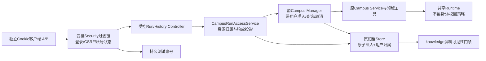

# Milestone 4A：可信身份与校园 Run 归属设计

日期：2026-10-03。状态：**只读源码审查后的待评审设计，未实施**。用户授权本轮完成4A详细设计和测试清单；没有授权本轮修改生产代码、数据库或开放服务。工程方向为权限、持久化与恢复。保持未提交、未推送。

## 1. 目标、场景和阶段边界

一句话：两个普通测试用户分别登录本机受控入口，各自启动、查看和取消自己的校园学分任务，并查询自己的历史；知道他人的UUID也不能访问。

4A只交付可信登录、校园Run归属、受控结果读取和真实回环HTTP验收。继续单实例、回环绑定、现有PostgreSQL和两条独立Agent循环；校园政策、证据、工具白名单、调用顺序及转人工保持knowledge领域层负责。共享Runtime不增加用户字段。

与[后端路线草案](../plans/2026-10-03-post-3a-backend-roadmap.md)相比，明确收窄4A：**不开放受控conversations/SSE/answers/feedback/治理API**。业务Session的归属、追问与持久化一起放到3B。否则4A需要同时修改会话控制状态、SSE异步发送和治理文件入口，超过本阶段最小范围。这是建议范围修订，不改写旧草案或宣称旧目标已实现。

维护账号只用来验证角色隔离；4A不给它资料写入权限，也不给个人Run的全局读取权。后续独立审核治理端口与文件权限后才能授予维护能力。

不做注册、找回密码、学校SSO、JWT、登录Session持久化、完整聊天记录、客户端幂等、持久取消、自动续跑、真实模型验收、非本机部署、真实学生试用。任务取消沿用当前进程内请求停止语义。不是生产认证服务。

## 2. 当前源码事实

下列位置按本轮真实源码读取，非按名称推断；文件哈希基线见[只读记录](../../evidence/milestone-4a/01-只读设计记录.md)。行号仅用于定位本轮版本。

| 当前事实 | 文件、类、方法依据 |
| --- | --- |
| Knowledge没有Security依赖 | [knowledge/pom.xml](../../../knowledge/pom.xml)，dependencies；根pom锁定Boot3.4.4 |
| 预览入口扫描web/feedback、自动激活匿名profile | [ZhkuLocalPreviewApplication](../../../knowledge/src/main/java/com/zhku/knowledge/web/ZhkuLocalPreviewApplication.java)，注解14行、main/setAdditionalProfiles30行；不能直接在main上附加受控profile |
| 治理是另一入口 | [ZhkuLocalAdminApplication](../../../knowledge/src/main/java/com/zhku/knowledge/governance/web/ZhkuLocalAdminApplication.java)，main、scanBasePackageClasses、zhku-local-admin |
| URL有统一/api上下文 | [application.yml](../../../knowledge/src/main/resources/application.yml)，server.servlet.context-path；Controller映射本身不含/api |
| 校园Controller没有可信主体 | [CampusAgentPreviewController](../../../knowledge/src/main/java/com/zhku/knowledge/web/CampusAgentPreviewController.java)，start32、find51、cancel60；请求为question/courses，UUID直接传Manager |
| 内存运行记录不保存用户 | [CampusCreditAgentManager](../../../knowledge/src/main/java/com/zhku/knowledge/campusagent/CampusCreditAgentManager.java)，start89、find147、cancel170、lookup176、ManagedRun；投递前归档准入，终态顺序已有3A验证 |
| 归档准入未绑定用户 | [CampusRunArchiveStore](../../../knowledge/src/main/java/com/zhku/knowledge/campusagent/archive/CampusRunArchiveStore.java)，admit(UUID)；[JdbcCampusRunArchiveStore](../../../knowledge/src/main/java/com/zhku/knowledge/campusagent/archive/JdbcCampusRunArchiveStore.java)，admit50、INSERT |
| 历史可以按裸UUID和全表分页读取 | 同JdbcStore，find127、list157；[CampusRunHistoryService](../../../knowledge/src/main/java/com/zhku/knowledge/campusagent/archive/CampusRunHistoryService.java)，find15/list24；[历史Controller](../../../knowledge/src/main/java/com/zhku/knowledge/web/CampusAgentHistoryPreviewController.java)，find/list |
| 数据库只有进程owner，没有用户owner | [V18](../../../knowledge/src/main/resources/db/migration/V18__create_campus_agent_run_archive.sql)，owner_instance_id/owner_epoch；[CampusRunArchiveOwner](../../../knowledge/src/main/java/com/zhku/knowledge/campusagent/archive/CampusRunArchiveOwner.java)，start/claim/probe；进程锁不能替代用户身份 |
| 历史资料撤回门禁已有实现 | [CampusRunHistoryVisibility](../../../knowledge/src/main/java/com/zhku/knowledge/campusagent/archive/CampusRunHistoryVisibility.java)，evaluate17；原sourceId/version、发布/可见/分享/范围/定位检查；JdbcStore.find在同一REPEATABLE_READ事务读取 |
| 在线Snapshot直接取缓存结果 | Manager.snapshot：completion.result里的answer/source/steps；未在每次在线读取时重新核验资料，所以受控接口不能直接透传裸find结果 |
| 校园PolicyGateway内部创建独立会话 | [CampusAgentPreviewConfiguration](../../../knowledge/src/main/java/com/zhku/knowledge/web/CampusAgentPreviewConfiguration.java)，zhkuCampusCreditAgentManager52、policyGateway61–62；不是用户可复用的业务Session |
| 领域循环已经守住工具和证据 | [CampusCreditAgentService](../../../knowledge/src/main/java/com/zhku/knowledge/campusagent/CampusCreditAgentService.java)，构造器internalToolExecutionEnabled(false)76、run93、decide138；lookup→合格政策→纯计算，失败/转人工由领域判定 |
| 领域依赖的会话默认内存 | [ZhkuLocalPreviewConfiguration](../../../knowledge/src/main/java/com/zhku/knowledge/web/ZhkuLocalPreviewConfiguration.java)，zhkuLocalPreviewConversationStore78、zhkuLocalPreviewConversationFacade203；[LocalPreviewConversationFacade](../../../knowledge/src/main/java/com/zhku/knowledge/web/LocalPreviewConversationFacade.java)，createConversation/sendMessage |
| 旧会话有同路径JSON/SSE两种处理 | [ZhkuLocalPreviewConversationController](../../../knowledge/src/main/java/com/zhku/knowledge/web/ZhkuLocalPreviewConversationController.java)，create/sendMessage/streamMessage/cancel；不能只保护JSON |
| 回环和归档配置都有独立检查 | [LocalPreviewBindingGuard](../../../knowledge/src/main/java/com/zhku/knowledge/web/LocalPreviewBindingGuard.java)，构造器；[CampusRunArchiveConfiguration](../../../knowledge/src/main/java/com/zhku/knowledge/web/CampusRunArchiveConfiguration.java)，archiveDataSource46，显式目标且拒绝URL query |

3A的272通过是上一阶段当前有效基线，不是本轮执行结果；本轮不运行测试、数据库或模型。源码已确认最高迁移V18，候选V19实施前再查编号。

## 3. 方案选择

| 方案 | 取舍 |
| --- | --- |
| 推荐：独立受控启动入口，框架Cookie登录Session，持久userId和Run归属 | 便于逐入口关闭旁路；账号重启不变，登录重启失效；只增加必要依赖和领域适配 |
| 在旧匿名Controller统一套登录 | 新依赖和profile会同时影响问答/SSE/治理；裸UUID服务调用仍可能绕过；需要更大迁移，不选 |
| 现在接OIDC/JWT和完整多租户权限 | 尚无学校身份来源和部署条件；引入令牌刷新/发行/院系授权问题，不选 |

推荐以Spring Security已有formLogin过滤器处理登录，成功/失败handler返回JSON，关闭默认页面、重定向和HTTP Basic。登录请求用application/x-www-form-urlencoded的username/password；校园任务仍用JSON。这样复用框架认证、Session固定攻击防护和SecurityContext持久化，不写一个只调用authenticate却遗漏Session保存/轮换的自制登录Controller。

## 4. 架构与装配隔离

新增入口候选为com.zhku.knowledge.controlled.ControlledPreviewApplication；只扫描controlled/security两个包，显式导入必要原领域装配，不扫描整个knowledge，也不扫描原web Controller。用zhku-controlled-preview profile，仍要求显式回环地址、显式临时/受控数据库目标、archive=true；禁止同启zhku-local-preview或zhku-local-admin。

需要复用的ZhkuLocalPreviewConfiguration和CampusRunArchiveConfiguration只把profile条件扩展到受控profile，其Bean方法和领域算法不改。受控入口显式import，不开启旧profile。原CampusAgentPreviewConfiguration保持原模式；新增ControlledCampusAgentConfiguration按相同构造链装配原Service、固定工具、policyGateway、2worker/16queue/30秒Manager，并要求归档存在，不允许静默内存退化。允许少量局部装配重复，不为复用建立新生产框架。

ControlledPreviewConfiguration在Bean实例化前验证模式互斥、显式数据库URL/用户、回环和开关，不能等创建资料DataSource后才发现目标缺失并默认连接54329。受控模式不装配RAG/SSE/反馈/治理/遥测扩展；policyGateway复用原四级非RAG证据链。已有原遥测Bean可保留构造供领域门面使用，其匿名维度不添加userId，不能借认证改成个人追踪。

受控启动必需条件固定为：profile=zhku-controlled-preview、zhku.controlled-preview.enabled=true、zhku.campus-agent.enabled=true、zhku.campus-agent.archive.enabled=true、显式zhku.db.url/user与回环地址。复用原领域Bean还需zhku.local-preview.enabled=true；这个属性只允许内部领域装配，不激活旧profile或Controller。zhku.rag.enabled、zhku.streaming.enabled和zhku.local-admin.enabled必须false；缺少条件直接失败，不静默启动一个残缺的受控服务。仅新增受控配置文件，不修改旧配置默认值。

模型装配的必要细节：原[配置](../../../knowledge/src/main/java/com/zhku/knowledge/rag/RagProviderConfiguration.java)只有rag.enabled时才提供Profile与KeyResolver，不能既禁止RAG又依赖它自动提供Bean。受控Campus配置只读取明确命名的现有profile白名单键，调用[RagProviderProfileResolver.profile(name)](../../../knowledge/src/main/java/com/zhku/knowledge/rag/RagProviderProfileResolver.java)（不使用需要enabled的activeProfile），以及[ApiKeyResolver.systemEnvironment](../../../knowledge/src/main/java/com/zhku/knowledge/rag/ApiKeyResolver.java)/既有CourseCreditChatModelFactory，绝不导入RagProviderConfiguration或创建embedding/retriever。profile仍有既有embedding/index字段要求，本阶段不改它们的契约或声称已使用。模型Bean允许显式src/test夹具先行提供，且必须验生产默认缺配置/密钥失败，不存在假模型回退。4A实际网络验收只有测试替身，既有工厂的真实供应商行为继续留到5；不修改工厂。

新增Security依赖会使Boot为旧应用自动装配默认认证。因此候选在原预览与治理Application分别排除SecurityAutoConfiguration、UserDetailsServiceAutoConfiguration；只在原独立匿名入口保持原行为。受控Application不排除，显式提供安全过滤链及账号Provider，不产生默认用户/随机密码日志。实际类名及自动配置行为在实施前用项目Boot3.4.4依赖核对；旧入口真实HTTP/Context回归必须验证。原入口始终回环，排除并不意味着允许非本机匿名服务。

受控安全链覆盖全部请求：仅明确开放CSRF获取和登录；用户/角色路径逐项授权，其余denyAll。未映射路径不能因另一个无匹配过滤链而绕过。ERROR转发仅允许框架固定错误处理，统一安全JSON且不包含异常原文；直接请求/error不作为公开入口。4A不创建ASYNC/SSE端点，仍测试Accept协商、ERROR/ASYNC转发和路径编码不能触达旧资源。

## 5. 身份、账号和登录生命周期

初期只有合成账号user-a、user-b（角色USER）和maintainer（角色MAINTAINER）。MAINTAINER不自动包含USER。不绑定学号、真实姓名、邮箱或院系；不宣称这些身份已经代表真实学生或校园资料授权体系。

候选新表preview_identity：user_id UUID主键、login_name唯一且只允许规范化ASCII测试名、password_hash、role（USER/MAINTAINER）、enabled、auth_revision、created_at。不保存密码原文/APIKey。主键由一次显式建账号操作生成，不能每次启动随机生成或以进程owner替代；不支持账号删除/修改HTTP接口。

显式PreviewIdentityBootstrapCli只读环境密码并创建三账号：数据库操作前重新解析既有凭据；账号密码来自专用环境变量，不放argv/仓库/日志。用带{bcrypt}前缀的框架PasswordEncoder，拒绝noop与未知编码；密码按ASCII限定16–64字符，避免BCrypt字节截断。已存在任何目标账号则整体拒绝，不静默重置密码、角色或ID。CLI只写显式受控/临时目标，不作为应用启动自动seed。测试用随机密码和显式夹具。

登录后的Principal只携带userId、角色和authRevision，不携带密码哈希；TrustedActor由服务端认证上下文构造。Provider在校验密码后只返回该Principal，凭据及时擦除，不把带hash的数据库User记录塞进HttpSession。每个受保护请求检查当前enabled/revision，错误或无法查询则拒绝，不靠登录时的缓存授权。更新revision/停用账号使旧Cookie不再授权，需重新登录。4A没有管理账号更新API；验收由临时库夹具改变状态。

使用容器内存HttpSession，空闲15分钟过期，登录明确changeSessionId，Cookie名ZHKU_CONTROLLED_SESSION、HttpOnly、SameSite=Strict、Path=/api/zhku/controlled-preview/v1。4A回环HTTP的Secure=false是本阶段明确限制；4B TLS必须改Secure=true并重新验收，不能把本机Cookie设置用于非本机。关闭remember-me、Basic和默认登录页面；无跨域许可。CSRF存HttpSession，GET获取token，登录后重新获取，所有POST（含登录/注销/取消）必须提交token。

注销使登录Session和安全上下文失效并删除Cookie；不删除历史、不等同于取消正在执行的Run。已受理任务可继续收尾，但用户之后无有效登录不能取结果。重启要求重新登录；业务Session恢复属于3B。

账号Repository采用有界I/O（最多2在途、无队列、调用宿主等待≤2秒），失败503；关闭释放专用资源，不使用请求线程无限等待。登录全实例最多20次/60秒，超限429且模型/工具0；这是本机预览的最小保护，不宣称抗公网攻击。具体I/O与时间窗口实现放入后续任务计划，不新增通用限流平台。

## 6. 入口矩阵与HTTP约定

外部URL以下均带/api；Security matcher使用不带context-path的Servlet路径。不能把/api再写一遍导致规则失配。

| 方法与外部路径 | 匿名 | USER | MAINTAINER | 说明 |
| --- | --- | --- | --- | --- |
| GET /api/zhku/controlled-preview/v1/auth/csrf | 200 | 200 | 200 | 返回headerName/token，无个人资料，Cache-Control:no-store |
| POST …/auth/login | 凭据正确200/错误401 | 同一登录流程 | 同一登录流程 | form参数+CSRF，不能提供userId/role覆盖服务器记录 |
| POST …/auth/logout | 401 | 204 | 204 | 已认证且CSRF正确；无有效CSRF可先403 |
| GET …/auth/me | 401 | 200 | 200 | 仅当前userId/role，不列账号或返回哈希 |
| POST …/runs | 401 | 正常受理202 | 403 | 只接受原question/courses白名单；身份字段/未知字段400 |
| GET …/runs/{runId} | 401 | 自己200，他人/不存在404 | 403 | 先数据库归属许可，再内存记录；内存过期404，历史另查 |
| POST …/runs/{runId}/cancel | 401 | 自己200，他人/不存在404 | 403 | CSRF先校验；只请求停止，不提前宣布terminated |
| GET …/history、…/history/{runId} | 401 | 自己200，他人/不存在404 | 403 | SQL归属过滤后keyset分页；默认20、最大100 |
| 旧/local-preview/*（页面/answers/conversations/JSON/SSE/cancel/campus runs/history） | 不开放 | 不开放 | 不开放 | 不装配且兜底deny，不能仅要求已登录 |
| /api/zhku/feedback、/api/zhku/local-admin/*及其页面/遥测/反馈/上传/发布 | 不开放 | 不开放 | 不开放 | 维护角色也无旁路权限 |
| 默认/login、/logout、静态旧预览页、其他路径/方法 | 不开放 | 不开放 | 不开放 | 不存在公共页面/查询/管理端口；受控模式精确拒绝 |

状态码优先级：框架CSRF对不安全方法可先403（包括匿名POST）；匿名访问保护GET为401；通过CSRF与登录后再判断角色403/资源404。测试要区分这些输入，不能把全部未登录POST都硬判401。存储/授权I/O故障503、不泄露正文；身份字段语法错误400；超限429；资料撤回不是权限404，自己的历史仍200且正文HIDDEN。

原匿名v1九字段Snapshot及HTTP成功格式保持不变。新受控Run响应采用独立白名单封装：{run:原九字段Snapshot, resultVisibility:RUNNING|NOT_APPLICABLE|VISIBLE|HIDDEN|UNCONFIRMED}。新增封装只用于新入口，不改原DTO字段。错误仍固定code/message；已提交准入且投递后响应投影失败，503可附本人runId与accepted=true；不能说“未受理”或自动再次start。准入ACK未知没有已确认accepted，使用固定UNCONFIRMED代码，不猜测未执行；本阶段无幂等重试承诺。

登录请求密码和响应Cookie/token不得写入验收报告或日志；测试报告以A/B客户端代号、资源ID、状态码、计数和断言表示。对个人响应加no-store，禁用错误堆栈/详细message。

## 7. 原子归属、内存与数据库读写

候选V19增量：新身份表；campus_agent_run_archive新增nullable owner_user_id（外键身份表RESTRICT，旧记录保持NULL），以及(owner_user_id, admitted_at DESC, run_id DESC)索引。owner_instance_id/epoch继续是宿主执行所有权，列语义不变。归属只在INSERT写入，数据库约束/窄触发器禁止任何UPDATE改变owner_user_id，包括NULL变为用户；不迁移或认领旧匿名Run。

Store新增明确的admitOwned(runId,TrustedActor)、findOwned(TrustedActor,runId)、listOwned(TrustedActor,limit,cursor)；TrustedActor提供userId及本次认证authRevision用于SQL核验，不是客户端DTO。原方法保留。若需要接口默认实现以兼容旧替身，默认必须显式不支持受控操作，不能退回裸UUID读或匿名admit。身份信息只在knowledge存储/管理边界，不加入AgentRunContext/AgentRunSnapshot。

admitOwned沿用3A同一writer事务、owner行锁、容量、清理、guardWrite和commit未知处理；同一INSERT绑定owner_user_id。用户enabled/revision/USER角色确认在准入事务内锁定该用户行FOR SHARE，和账号停用/角色更新序列化，锁顺序固定owner→identity。Task只能在准入确认后投递。不能先start裸任务后再异步保存归属，也不能用两个独立表事务做后补授权。提交未知不投递、不重试；容量满但清理已成功仍沿用3A提交清理分支。

findOwned在SQL中同时限定run_id、owner_user_id、保留期、enabled、USER角色与当前认证revision，随后才decode payload/evaluate证据；资源判断和证据门禁处于同一读取快照。listOwned先WHERE过滤再LIMIT+1/游标；没有全表total或他人的ID/时间/占位符。借用他人的cursor不能改变owner条件，也不表示访问他人的资源；非法cursor400。

原匿名find/list在新二进制中追加owner_user_id IS NULL，仅可见原匿名记录；新受控查询严格非NULL，两个命名空间互不相认。历史数据不转移、不由首个登录用户领取；过期清理不清除归属后重新公开。

Manager新增startOwned(request,TrustedActor)、findOwned(TrustedActor,runId)/cancelOwned(TrustedActor,runId)的受控调用，旧start/find/cancel只允许内存无主记录。ManagedRun新增final userId；显式随任务对象传递，不依赖线程池继承SecurityContext，不把整个Authentication或密码留入运行上下文。受控start必须有归档Store；误装配无归档立即失败。非Controller调用同样要求USER主体，归属匹配发生在返回Snapshot/发出stop之前；受控门面负责本次数据库许可与展示门禁，不能让后台调用裸UUID绕开内存归属。

CampusRunAccessService是单一受控应用门面，不是新运行骨架：校验可信主体→按用户查归档许可→Manager归属匹配→投影回复。取消在Manager admissionLock下再次匹配immutable userId才调用requestStop；归属永不变，因此先数据库许可、后内存匹配不会取消另一用户任务。账号停用与查询以授权快照为线性化点：已经获得许可的在途请求允许完成，之后的新请求拒绝；不承诺撤回已发送的字节或强停宿主任务。

归档已有owner fencing、final CAS、清理、关闭排空和重启对账不变；用户身份不参与执行终态判断。最终归档只改结果事实，不修改归属。用户角色变化/注销不将SUCCEEDED改FAILED，也不借USER_REQUEST伪造账号撤销原因。

## 8. 受控响应与资料门禁

这是当前裸在线Snapshot的适配差距，不修改原领域循环或原匿名响应。受控门面不能用“用户拥有Run”代替资料许可。

- 活跃任务：RUNNING；使用已授权的元数据，answer/source为空。
- 正常ANSWERED：优先用同次findOwned结果中已通过原来源门禁的归档白名单载荷组成answer/source，resultVisibility=VISIBLE；原终态、stopReason、terminated不改。
- 已完成但来源撤回、版本不符或schema不支持：HIDDEN，answer/source为空；保留真实执行状态，历史同样隐藏，不回写成执行失败。
- 在线已完成但final未确认、归档仍ADMITTED或没有可确认载荷：UNCONFIRMED，保留终态/terminated，answer/source为空；不以缓存正文绕过当前许可，也不补写或重跑。直接归档读故障则503。
- NEED_CLARIFICATION/HANDOFF/CANCELLED/FAILED：NOT_APPLICABLE；返回服务器固定澄清/转人工/取消文案，不透传自由模型文本；source为空。分类沿用原Result和共享Runtime。

steps保留number/name/status，detail在受控模式统一为空，不返回工具自由文本、模型Prompt、内部Session ID或完整事件日志。资料载荷仍使用3A编码/字段/UTF-8上限，引用性质仍REFERENCE_ONLY，不承诺同版本正文不可变。

上面的正文隐藏行为只属于新受控API，不能说旧匿名在线缓存已经逐次重核许可。4A对旧匿名历史加用户命名空间过滤，不顺手重写其他旧响应。

## 9. 候选修改文件与原因

以下全部是实施候选，本轮没有创建Java、SQL、配置、测试或依赖增量。目录缩写均从knowledge起。

| 原文件候选 | 原因 |
| --- | --- |
| knowledge/pom.xml | 仅新增Boot管理版本Security依赖和受控jar classifier；不升级Boot/AI，不给agent加依赖 |
| web/ZhkuLocalPreviewApplication.java、governance/web/ZhkuLocalAdminApplication.java | 隔离新增Security默认自动配置，原回环匿名入口兼容 |
| web/ZhkuLocalPreviewConfiguration.java、web/CampusRunArchiveConfiguration.java | 允许受控profile显式复用领域/归档Bean；原方法与默认逻辑不变 |
| campusagent/CampusCreditAgentManager.java | 窄受控方法及内存不可变归属，准入/查询/取消过滤；终态发布顺序不改 |
| campusagent/archive/CampusRunArchiveStore.java | 追加明确的owned准入和读取边界，不引入通用Repository平台 |
| campusagent/archive/JdbcCampusRunArchiveStore.java | 同事务归属、用户条件/匿名NULL隔离和分页，保留3A所有故障语义 |
| campusagent/archive/CampusRunHistoryService.java | 受控find/list入口复用原投影/游标；原方法只服务无主命名空间 |
| README.md、knowledge/README.md | 明确两种入口、测试路径和未验证边界；不宣传非本机生产身份服务 |

新增候选（完整源码根knowledge/src/main/java/com/zhku/knowledge/）：

- security/TrustedActor.java、PreviewIdentityRepository.java、PreviewSecurityConfiguration.java、PreviewIdentityBootstrapCli.java：固定身份记录、有界账号I/O、框架Provider/过滤链/请求状态核验、一次性建合成账号；不再套一层通用身份接口。
- controlled/ControlledPreviewApplication.java、ControlledPreviewConfiguration.java、ControlledCampusAgentConfiguration.java：独立扫描、启动前模式/目标验证、原Service及Manager接线。
- controlled/ControlledAuthController.java、ControlledCampusAgentController.java、ControlledCampusHistoryController.java：仅csrf/me与受控Run/history；login/logout由框架过滤器负责。
- controlled/CampusRunAccessService.java：归属门禁与安全响应投影，固定错误映射可放同包局部advice，不复用会吞异常的宽泛handler。
- knowledge/src/main/resources/application-zhku-controlled-preview.yml：回环、独立profile、Session/Cookie/日志边界、默认受控开关关闭；不含凭据、不默认套用演示库。
- knowledge/src/main/resources/db/migration/V19__create_preview_identity_and_run_ownership.sql：增量身份/不可变归属/索引；实施时编号复核，不改V1–V18。
- knowledge/scripts/verify-campus-identity-temp-db.ps1：独立临时目标/端口55435、无volume、随机密码、测试白名单、finally清理和环境恢复；原两个DB runner核心行为不改。
- docs/evidence/milestone-4a/下实施基线、差异、测试和验收：保存每批事实，不覆盖3A报告。

预期不修改：agent-runtime/、agent/、CampusCreditAgentService、CampusToolRegistry、CampusRunArchiveOwner、CampusRunHistoryVisibility、ConversationStore/JdbcConversationStore、LocalPreviewConversationFacade、所有旧Controller/政策证据算法/旧迁移/原成功DTO。若安全实现必须改这些循环或算法，先停止报告；不能把本设计变成3B或治理认证工程。

## 10. 测试分层与实施顺序

完整测试清单见[测试矩阵](../../evidence/milestone-4a/02-测试矩阵.md)。候选类尚不存在，条目不是本轮通过结果。

先保存当前文件/HEAD与XML基线，并重新执行3A四组272及构建、原两个临时库验收路径。新增V19后的schema最高编号断言只能在新阶段修订，不能改旧XML/验收统计；原Golden核心行为与临时目标保护必须保留。

建议后续任务计划依赖顺序：

1. 固化入口矩阵/敏感日志和新依赖旧模式影响的RED测试。
2. 临时真库身份/归属迁移与不可变约束，账号显式创建、稳定ID、密码校验。
3. Store owned事务和双命名空间SQL、commit未知/清理/fencing复验。
4. Manager受控准入、同ID跨用户取消防护、异步主体不串号；不改Service循环。
5. 独立装配与框架登录/CSRF/角色/停用，关闭所有旧入口。
6. 受控响应投影与资料撤回/ACK未知；组合测试同Run关联原Runtime。
7. 真实回环HTTP + 真库，最后独立子JVM重启、旧入口实际HTTP兼容、资源退出和全阶段回归。

普通快速测试使用账号/Store替身且明确标注；SQL隔离、准入原子性和竞争必须真库；登录Cookie与过滤链必须实际监听且由独立客户端请求。新进程验收必须不同PID，不能把Context重建算重启。所有模型都是src/test测试替身；生产配置不存在假模型回退，不外发供应商。

本轮不生成可冒充已经执行的未来-Dtest命令。实施任务计划将在书面设计评审后给出逐步文件、RED/GREEN、真实选类命令和资源门禁；不运行带RunLiveProvider开关的测试。

## 11. 完成标准

1. 两个USER和一个MAINTAINER身份在真库稳定，密码仅hash；重启后重新登录仍同userId，旧登录Cookie失效。
2. 登录Session轮换、csrf/login/logout/me、账号停用/revision及错误映射通过真实HTTP；客户端不继承Mock身份。
3. 归属和准入同事务，ACK未知不投递、匿名/受控双命名空间隔离；原清理、owner、final、终态顺序复验。
4. A/B各自Run在线与历史可查；互查互取消、不存在、列表/游标均不泄露；每个拒绝场景模型/工具0或原任务计数不变。
5. 受控在线和历史正文都受当前knowledge来源许可约束；撤回隐藏而执行事实保持，存储异常不透传缓存正文。
6. 全入口清单逐项拒绝旧问答、JSON/SSE、反馈、治理、静态页及默认认证路径；错误转发/编码不旁路，受控模式不意外注册旧Controller。
7. 原匿名API成功结构/默认回环/开关不变；新增Security未让旧模式出现随机密码、302登录或默认401。
8. 专用临时库、不同JVM、实际端口、资源收敛/退出、本轮回归和差异证据完整；测试计数以XML为准，不预承诺新增数量或重复计算。
9. 保持两循环及领域策略独立，Runtime无用户/校园字段；真实模型、业务Session、自动续跑、非本机和真实学生效果仍明确未验证。

## 12. 回滚和停止条件

停止受控准入、有界排空、关闭受控端口与专用账号I/O；保留身份、归属、归档和历史迁移。只撤回4A代码增量，不整体reset/clean，不DROP、不改Flyway历史，不自动把私有记录变NULL。不回滚到会读取受控库私有记录的旧归档二进制：旧单人模式必须使用独立原目标且不得接入受控库。数据库管理员和不参与新权限边界的旧程序不是本系统能拦截的用户；这项运行限制必须写入验收说明。

停止条件：需要开放治理/SSE才能验收Run；归属必须后补；无法保持证据门禁/安全投影；新依赖无法保持旧入口兼容；混合profile可绕过；需要把账号放Runtime；需要真实供应商/真实学生资料才能测试；需要重写Service循环/引入全局工作流；资源不收敛。发现时记录实际文件、现象、失败断言，修订设计后再推进，不擅自扩张。

## 13. 文档依据、自审与待评审决定

本轮按AGENTS通过Context7核对版本资料：选项目官方Spring Security6.4.4源码参考（匹配Boot3.4基线，具体依赖小版本实施时由BOM确认），没有拿Security7迁移代码套用。官方依据：[过滤链与兜底授权](https://github.com/spring-projects/spring-security/blob/6.4.4/docs/modules/ROOT/pages/servlet/configuration/java.adoc)、[CSRF](https://github.com/spring-projects/spring-security/blob/6.4.4/docs/modules/ROOT/pages/servlet/exploits/csrf.adoc)、[Session固定攻击与安全上下文](https://github.com/spring-projects/spring-security/blob/6.4.4/docs/modules/ROOT/pages/servlet/authentication/session-management.adoc)、[密码存储](https://github.com/spring-projects/spring-security/blob/6.4.4/docs/modules/ROOT/pages/features/authentication/password-storage.adoc)、[Boot3.4默认Security装配](https://docs.spring.io/spring-boot/3.4/reference/web/spring-security.html)、[Boot真实Web测试](https://docs.spring.io/spring-boot/3.4/reference/testing/spring-boot-applications.html)。库资料支持框架行为，不证明本项目已实现权限。

自审：已区分当前事实/候选设计/本轮检查/历史测试；身份owner和宿主owner分开；登录Session与3B业务Session分开；新响应与原九字段格式分开；登录form与任务JSON分开；CSRF先403与匿名GET401分开；正常执行事实与正文许可分开；真实HTTP/不同PID/模型替身证据分开。无TODO/TBD或假测试结果。

待用户评审的具体方案是：**先完成Run/history权限，所有会话/SSE/治理入口在受控模式关闭，采用预置账号+框架Cookie登录，新受控接口使用独立响应封装**。评审后再写可执行的逐任务实施计划；本轮不开始实现、不提交或推送。
